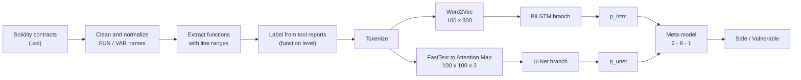
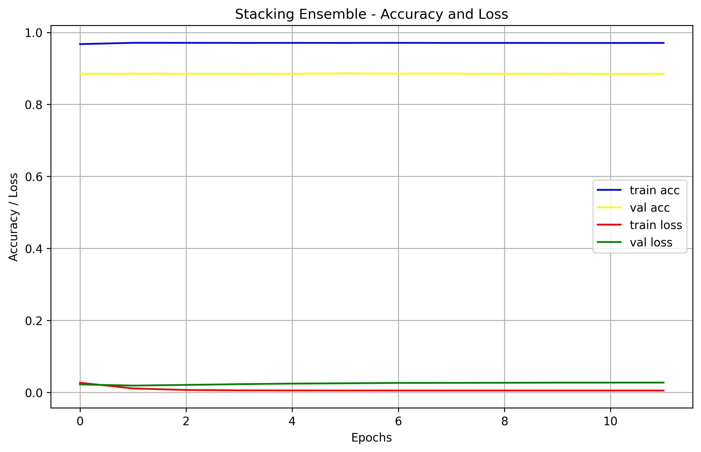

# Smart Contract Reentrancy Detection with a Hybrid BiLSTM–U-Net Model


A deep-learning pipeline that detects **Reentrancy** vulnerabilities in Solidity smart contracts at **function level**. Every function is represented in two complementary ways, a token-embedding sequence for a **BiLSTM** and a novel image-like **Attention Map** for a **U-Net**, and the two models are combined with a **Stacking Ensemble**.

**Author:** Sajjad Shahbazi
**Final code:** [`scripts85_colab_lstm`](scripts85_colab_lstm)

---

## Table of contents

1. [Overview](#overview)
2. [Smart contract vulnerabilities](#smart-contract-vulnerabilities)
3. [Scope of this project: Reentrancy](#scope-of-this-project-reentrancy)
4. [Pipeline](#pipeline)
5. [Method in detail](#method-in-detail)
6. [Models](#models)
7. [Training setup](#training-setup)
8. [Results](#results)
9. [Repository layout](#repository-layout)
10. [How to run](#how-to-run)
11. [Limitations](#limitations)
12. [Data source and references](#data-source-and-references)

---

## Overview

Smart contracts cannot be changed after deployment, so a security flaw such as Reentrancy stays exploitable and can cause large financial losses. Existing detection tools mostly rely on fixed rules defined by experts, and their efficiency and scalability decline as contract complexity increases.

This project proposes a hybrid method that uses two complementary sources of information at the same time:

- a **BiLSTM branch** that reads the Word2Vec token-embedding sequence of a function, and
- a **U-Net branch** that reads a novel image-like representation called the **Attention Map**. It is built from a token co-occurrence matrix (sequential information) and a semantic similarity matrix (semantic information), so that a convolutional network can detect dangerous code patterns in two dimensions.

Training the two branches jointly showed no improvement because of gradient interference and overfitting. Instead, the two models are trained **independently** and their output probabilities are combined by a small **Stacking Ensemble** meta-model. On the SmartBugs Wild dataset (47,398 smart contracts) the final model reaches **88.85% accuracy**, compared with 85.80% for the CBGRU baseline. Combining structural and semantic information through stacking gives more stable and accurate results than joint training.

**Keywords:** Smart Contract, Blockchain, Deep Learning, BiLSTM, U-Net, Attention Map, Stacking Ensemble

---

## Smart contract vulnerabilities

The following six vulnerability types are the most common ones in Ethereum smart contracts, and they are the types covered by the labels of the SmartBugs Wild analysis tools:

| Vulnerability | What happens | Typical impact |
| --- | --- | --- |
| **Reentrancy** | A malicious contract calls back into the vulnerable function before its first execution has finished, so the same balance can be withdrawn several times. | Drained funds (e.g. the DAO attack) |
| **Integer Overflow** | An integer grows beyond the maximum value of its type and wraps around to a small or negative value. | Wrong balances, bypassed checks |
| **Integer Underflow** | The opposite case: an integer drops below its minimum and wraps around to a very large value. | Unlimited balances, bypassed checks |
| **Timestamp Dependency** | Contract logic depends on the block timestamp, which a miner can manipulate within limits. | Rigged lotteries and time-based payouts |
| **Callstack Depth Attack** | An attacker deepens the call stack so that inner calls fail unexpectedly or consume too much gas. | Failed calls, unstable execution |
| **Infinite Loop** | The contract can get stuck in a loop that never terminates. | Blocked transactions, gas exhaustion |

Because a deployed contract is immutable, these flaws have to be found **before** deployment. Classic detection tools (Oyente, Mythril, Slither, Securify, SmartCheck, Manticore, HoneyBadger, Osiris, Maian) use static analysis, symbolic execution and pattern rules. Each of them covers only part of the vulnerability classes, they produce false positives and false negatives on complex contracts, and they scale poorly. Learning-based detectors extract features automatically from the code, which is the direction taken in this project.

---

## Scope of this project: Reentrancy

The implementation targets **Reentrancy** (`target_vulner = 'Reentrancy'`). It is a good first target because it is well defined, has a clear code-level signature (an external call followed by a state update), and is one of the most expensive vulnerabilities in practice.

A minimal example of the pattern the model has to recognize:

```solidity
function withdraw(uint amount) public {
    require(balances[msg.sender] >= amount);
    msg.sender.call.value(amount)();   // external call happens first ...
    balances[msg.sender] -= amount;    // ... state is updated afterwards
}
```

### Labeling at function level

Instead of labeling a whole contract as "vulnerable" or "safe", **every function is labeled individually**. This gives the model a much more precise learning signal, since in a large contract only one or two functions are usually responsible for the flaw.

1. The analysis tools report the **source line numbers** of every finding (stored under `results/<tool>/icse20/<contract>/result.json`).
2. Each function is extracted together with its **start line and end line**.
3. A function gets **label 1 (vulnerable)** if at least one tool reported Reentrancy on a line inside its range, otherwise **label 0 (safe)**.

To keep line numbers valid, all preprocessing steps preserve the line count of the contract.

### Three sample categories

Safe functions are split into two groups, so the dataset contains:

| Category | Label | Description |
| --- | --- | --- |
| `vulnerable` | 1 | Function flagged as Reentrancy |
| `sensitive_negative` | 0 | Not vulnerable, but uses a sensitive operator (`call`, `delegatecall`, `send`, `transfer`, `selfdestruct`) |
| `safe` | 0 | Not vulnerable and without sensitive operators |

The sensitive negatives are kept on purpose when the safe class is down-sampled. Without them, `call.value` would appear almost only in vulnerable functions and the network could learn the shortcut "contains `call.value` ⇒ vulnerable". With them it has to learn the real pattern (for example the order of the external call and the state update). Focal Loss handles the remaining class imbalance.

The final dataset contains **47,619 function-level samples** (28,520 safe and 19,099 vulnerable).

---

## Pipeline



---

## Method in detail

### 1. Source cleaning (`PreProcessTools.py`)

- remove the `pragma solidity` line,
- remove single-line and multi-line comments (multi-line comments are replaced by the same number of blank lines),
- remove non-ASCII characters and leading whitespace,
- replace user-defined function names by `FUN<N>` and variable names by `VAR<N>`, leaving Solidity keywords and common modifiers untouched.

Programmer-chosen names carry no information about the vulnerability. Normalizing them removes superficial differences so that two contracts with the same flaw look alike to the model.

### 2. Function extraction and tokenization

Functions are extracted with a regular expression and brace counting, which gives the full body plus start and end lines. A second regular expression tokenizes the code into Solidity keywords, operators and identifiers (including the `FUN`/`VAR` placeholders).

### 3. Fixed-length sequences

Each function becomes a sequence of **100 tokens** (shorter functions are zero-padded, longer ones truncated). An initial length of 10 tokens lost most of the important code, and 100 matches the input size of the CBGRU baseline.

All tokens of a function are collected into one list and embedded in a single step, so the embedding model sees the complete function as context and not one line at a time.

### 4. Global embeddings

Every token is mapped to a **300-dimensional** vector:

- **Word2Vec** (CBOW) for the BiLSTM branch,
- **FastText** for the U-Net branch (it also handles rare tokens through character n-grams).

Both models are trained **once on the whole corpus** (a sample of up to 15,000 contracts) instead of once per function. With per-function models, a token such as `call` receives a completely different vector in every function and the network cannot generalize patterns like `call.value`. With a shared model all functions live in one vector space.

### 5. Attention Map (U-Net input)

A matrix of token embeddings has no spatial structure across its columns, so it is not a meaningful input for a convolutional network. The Attention Map solves this by turning a function into a square, image-like tensor in which each cell describes the relation between two tokens. Its shape is `100 × 100 × 3`:

| Channel | Content |
| --- | --- |
| 1. Co-occurrence | 1 if two tokens are at most 3 positions apart, otherwise 0 |
| 2. Similarity | Cosine similarity of the FastText vectors, rescaled from [-1, 1] to [0, 1] |
| 3. Interaction | Channel 1 × Channel 2 (similar **and** close) |

The first design used a single channel (similarity × co-occurrence). It was ambiguous, because "the tokens are far apart" and "the tokens are close but semantically opposite" both produce 0. Keeping the signals in three channels removed this ambiguity. Together with global embeddings, this raised the accuracy of the U-Net branch from **84.11% to 88.52%**.

---

## Models

| Model | Input | Architecture | Parameters |
| --- | --- | --- | --- |
| **BiLSTM** | `100 × 300` | BiLSTM(128) → Dropout(0.5) → BiLSTM(64) → Dense(1, sigmoid) | ~603 K |
| **U-Net** | `100 × 100 × 3` | Conv encoder (64-128), bottleneck 256 with SpatialDropout2D(0.3), decoder with skip connections, global average + max pooling, Dense(128) → Dropout → Dense(64) → Dense(1, sigmoid) | ~949 K |
| **Concatenate** (joint training, for comparison) | both | Both branches trained together, 128 + 128 features concatenated into a dense head | ~1.59 M |
| **Stacking Ensemble** (final) | `[p_lstm, p_unet]` | Dense(8) → Dense(1, sigmoid), on top of the two frozen, independently trained models | 65 |

**Why stacking works better than concatenation.** In joint training, the gradients of the large convolutional branch dominate and disturb the recurrent branch, and the large combined model overfits. In stacking, the two base models are already trained and fixed, so the meta-model has nothing to disturb and only 65 parameters to overfit.

---

## Training setup

| Setting | Value |
| --- | --- |
| Optimizer | Adam, learning rate 0.001 |
| Loss | Focal Loss, α = 0.25, γ = 2 |
| Epochs / batch size | up to 50 / 128 |
| Early Stopping | patience 10, best weights restored (monitor: `val_loss`, for the U-Net `val_accuracy`) |
| ReduceLROnPlateau (U-Net) | monitor `val_accuracy`, factor 0.5, patience 4, min lr 1e-6 |
| Split | 80 % train / 20 % test, `random_state=42` (same split for every model) |
| Hardware | Google Colab, NVIDIA Tesla T4, High-RAM runtime |

The dataset is prepared once on a local machine (the cached data is about 150 GB) and then uploaded to Google Drive for training on Colab.

---

## Results

Test set: **9,524 samples**. A majority-class baseline (always predicting "safe") reaches only **59.67%**.

| Model | Accuracy | Precision (Vuln.) | Recall (Vuln.) | F1 (Vuln.) | Precision (Safe) | Recall (Safe) | F1 (Safe) |
| --- | --- | --- | --- | --- | --- | --- | --- |
| BiLSTM only | 87.33% | 0.87 | 0.80 | 0.84 | 0.87 | 0.92 | 0.90 |
| U-Net only (Attention Map) | 88.52% | 0.86 | 0.86 | 0.86 | 0.90 | 0.90 | 0.90 |
| Concatenate (joint training) | 87.59% | 0.85 | 0.84 | 0.85 | 0.89 | 0.90 | 0.90 |
| **Stacking Ensemble** | **88.85%** | 0.86 | **0.87** | 0.86 | 0.91 | 0.90 | 0.91 |

Key observations:

- The **U-Net with Attention Map** beats the BiLSTM by 1.19 points and is far better balanced between the two classes: the BiLSTM misses about 20% of the vulnerable functions (recall 0.80), the U-Net about 14%.
- **Concatenate** is even weaker than the U-Net alone, which confirms that joint training is the wrong way to combine the branches here.
- The **Stacking Ensemble** is the best model in both accuracy and recall on the vulnerable class (0.87).
- Compared with the CBGRU baseline (85.80%, with 74.60% for its BiLSTM-only model), the BiLSTM branch of this project reaches 87.33%, which shows the benefit of global embeddings and the improved preprocessing.

### Training curves

**BiLSTM only**


**U-Net only (Attention Map).** Best validation accuracy at epoch 49; ReduceLROnPlateau lowered the learning rate at epochs 15, 38 and 47.


**Concatenate (joint training).** Early Stopping ended training after 21 epochs; the gap between training accuracy (0.9356) and validation accuracy (0.8837) shows the overfitting of the large joint model.


**Stacking Ensemble (final model).** The 65-parameter meta-model reaches its best validation loss at epoch 3.



---

## Repository layout

| Path | Content |
| --- | --- |
| `contracts/` | Solidity source files (`.sol`) of the SmartBugs Wild dataset |
| `results/` | Output of the analysis tools, used to label vulnerable lines |
| `scripts85_colab_lstm/` | **Final code** (`PrepareDataSet.py`, `PreProcessTools.py`) and output figures |
| `scripts*/` | Earlier experiment iterations (kept for history) |
| `requirements.txt` | Python packages (full `pip freeze` of the local Windows environment) |

- `PrepareDataSet.py`: dataset construction (labels, tokens, embeddings, Attention Maps), model definitions and all training entry points.
- `PreProcessTools.py`: source-code cleaning and identifier normalization.

---

## How to run

### 1. Requirements

- Python 3.10+, TensorFlow/Keras 2.16 (`.keras` model format), `gensim`, `scikit-learn`, `numpy`, `matplotlib`.
- Training needs a GPU runtime (the experiments used Colab with a Tesla T4 and High-RAM). The stacking step loads the whole dataset into memory (several GB).
- Dataset construction needs a lot of disk space (about 150 GB of cached `.pkl` files), so it is meant to run on a local machine.

On Colab:

```python
!git clone https://github.com/sajjadshahbazi/smartbugs-wild-with-content-and-result.git /content/smartbugs-wild-with-content-and-result
%cd /content/smartbugs-wild-with-content-and-result/scripts85_colab_lstm
!pip install gensim scikit-learn matplotlib
```

`requirements.txt` is a complete `pip freeze` of a local Windows machine (it contains `tensorflow-intel`). On Colab or Linux install the packages above and keep the preinstalled TensorFlow.

### 2. Configure the paths

At the top of `PrepareDataSet.py` set `ROOT` to the folder that contains `contracts/` and `results/`:

```python
ROOT = '/content/smartbugs-wild-with-content-and-result'   # Colab / Linux (default)
```

Derived paths: cache folder `ROOT/vectorcollections_img`, models and figures in `ROOT/output`, global embedding models `ROOT/global_word2vec_model.bin` and `ROOT/global_fasttext_model.bin`.

> The module changes the working directory to `ROOT/contracts` when it is imported, so this folder must exist (it can be empty if you only train from an existing cache).

### 3. Build the dataset (run once, local machine)

This creates the `emb_*.pkl` (BiLSTM input) and `att_*.pkl` (U-Net input) batches. Labels are read from `ROOT/results/<tool>/icse20/<contract>/result.json`.

```python
import os
import PrepareDataSet as p
from gensim.models import FastText, Word2Vec

files = [os.path.join(p.PATH, f) for f in os.listdir(p.PATH) if f.endswith('.sol')]

ft  = FastText.load(p.GLOBAL_FASTTEXT_PATH) if os.path.exists(p.GLOBAL_FASTTEXT_PATH) else p.build_global_fasttext_model()
w2v = Word2Vec.load(p.GLOBAL_WORD2VEC_PATH) if os.path.exists(p.GLOBAL_WORD2VEC_PATH) else p.build_global_word2vec_model()

for batch_index, i in enumerate(range(0, len(files), p.batch_size)):
    p.process_batch_with_categorization_for_unet(
        files[i:i + p.batch_size], p.target_vulner, p.batch_size, batch_index,
        global_fasttext_model=ft, global_word2vec_model=w2v)
```

The same code is available, commented out, in the `if __name__ == "__main__":` block of `PrepareDataSet.py`.

Each batch is saved as `emb_<category>_batch_<i>.pkl` and `att_<category>_batch_<i>.pkl` with the categories `vulnerable`, `sensitive_negative` and `safe`. The generated data is not stored in this repository because of its size. Upload the balanced dataset to Google Drive and mount it in Colab:

```python
from google.colab import drive
drive.mount('/content/drive')
# then point ROOT in PrepareDataSet.py to the folder on Drive (or copy vectorcollections_img to /content/...)
```

### 4. Train and evaluate (Colab, GPU)

Run the steps in this order (each can also be started from the `__main__` block of `PrepareDataSet.py`):

```python
import PrepareDataSet as p

p.train_LSTM()               # 1. BiLSTM branch   -> output/final_LSTM_model.keras
p.test_unet_branch_alone()   # 2. U-Net branch    -> output/final_unet_only_model.keras
p.check_ensemble_potential() # 3. (optional) how much do the two models' errors overlap?
p.train_stacking_ensemble()  # 4. final model     -> output/final_stacking_ensemble.keras
p.train_UNET_LSTM()          # (optional) joint / concatenate model, for comparison only
```

`train_stacking_ensemble()` needs the models from steps 1 and 2 and relies on the same fixed split (`random_state=42`). Every training function prints the classification report (accuracy, precision, recall and F1 per class) and saves its training curve as a `.png` in `ROOT/output`.

---

## Limitations

- Only the **Reentrancy** vulnerability is covered. The pipeline itself is not tied to it and the other types listed above can be added by changing the target vulnerability and the sensitive-operator list.
- The train/test split is made at the **function level**, not at the contract level, so functions of the same contract can appear in both sets.
- The preprocessed data (especially the Attention Maps) is very large, about 140–150 GB, and needs suitable infrastructure.
- The ensemble is hard to interpret: it is difficult to tell whether sequential or structural features drove a specific decision.
- Comparisons with other published models are only directly valid when they use the same dataset and vulnerability type (CBGRU does).

---

## Data source and references

- **SmartBugs Wild** dataset: Durieux et al., 2020. Contracts and analysis-tool outputs come from this dataset.
- **CBGRU**: Zhang et al., 2022. Baseline used for comparison; the sequence length and embedding size follow this approach.
- **Focal Loss**: Lin et al., 2017.
- **U-Net**: Ronneberger et al., 2015.
- **Word2Vec**: Mikolov et al., 2013. **FastText**: Bojanowski et al., 2017.
